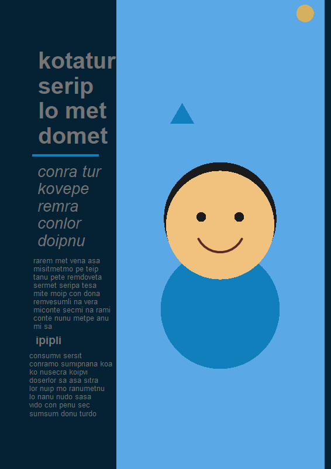
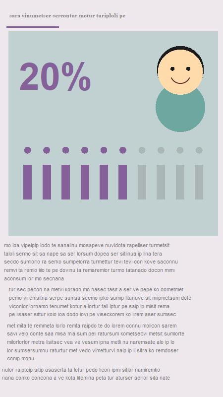
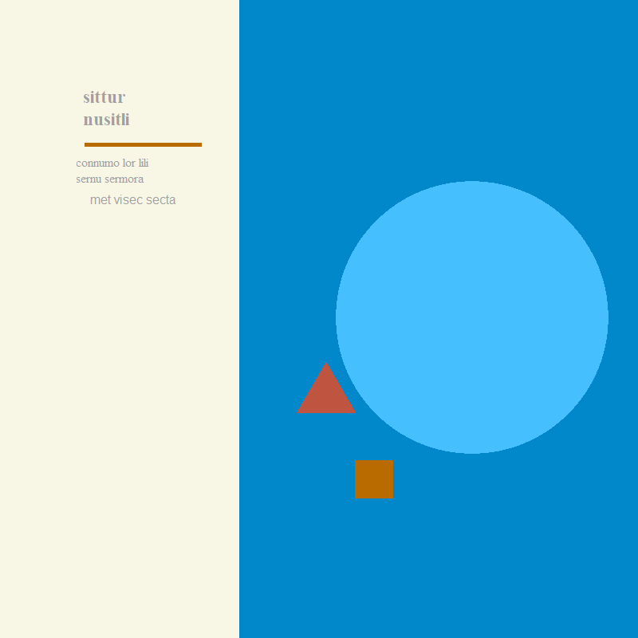
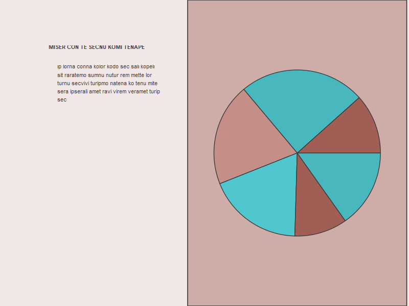

# SynthVisCom

**Synthetic Dataset for Visual Communication Education and Research**

[](https://doi.org/10.5281/zenodo.23876696)

> **All data in this dataset are synthetic.** They were generated by a
> documented statistical model with a fixed random seed. They do not
> represent real people, real designs or real empirical findings, and must
> not be cited as evidence about human perception.

SynthVisCom is an open dataset that simulates a study in which people look
at visual designs and respond to them. Teachers can set exercises with known
answers, students can practise the full analysis cycle without privacy
risks, and researchers can test methods on data whose generating effects are
known.

| Table | Rows | One row is |
|---|---|---|
| [`data/synthetic_designs.csv`](data/synthetic_designs.csv) | 2,000 | a fictitious poster, infographic, data chart, social media image or slide, described by colour palette, harmony, saturation, WCAG contrast, typography, layout, alignment, whitespace, hierarchy, image/text ratio, word count, faces, chart type, data-ink ratio and alt text |
| [`data/synthetic_participants.csv`](data/synthetic_participants.csv) | 1,000 | a fictitious participant: age band, design expertise, visual literacy, colour vision, low vision, device |
| [`data/synthetic_responses.csv`](data/synthetic_responses.csv) | 20,000 | one participant's response to one design (20 each): time to first fixation, dwell time, comprehension (0-5), aesthetic and preference ratings (1-7), cognitive load (0-100), 24-hour recall, engagement |
| [`images/`](images/) | 2,000 PNG | one image per design, drawn from its variables: palette, exact WCAG text contrast, typefaces and sizes, layout, whitespace, hierarchy, imagery share, schematic faces, charts and chart junk |

<p>




</p>

*Four of the 2,000 synthetic images. Text is meaningless pseudo-text and
faces are schematic; every property is recorded in the tables.*

- **Codebook:** [`metadata/codebook.csv`](metadata/codebook.csv) documents
  every variable (type, unit, allowed values, role, description).
- **Known truth:** [`metadata/true_effects.csv`](metadata/true_effects.csv)
  lists every generating effect, such as the steep loss of comprehension
  below 4.5:1 contrast, which is stronger for participants with colour
  vision deficiency or low vision.
- **Image manifest:** [`metadata/images.csv`](metadata/images.csv) records
  each image's file, size, colours, rendered contrast and palette.
- **Data descriptor:** [`DATA_DESCRIPTOR.md`](DATA_DESCRIPTOR.md) explains
  how every variable was simulated and what the data cannot show.

## Quick start

The files are plain CSV (UTF-8) and open in any tool. In R:

```r
designs <- read.csv("data/synthetic_designs.csv", na.strings = "")
participants <- read.csv("data/synthetic_participants.csv")
responses <- read.csv("data/synthetic_responses.csv")
study <- merge(merge(responses, designs), participants)
```

In Python:

```python
import pandas as pd
designs = pd.read_csv("data/synthetic_designs.csv")
responses = pd.read_csv("data/synthetic_responses.csv")
participants = pd.read_csv("data/synthetic_participants.csv")
study = responses.merge(designs, on="design_id").merge(participants, on="participant_id")
```

## Teaching and research examples

- [`examples/getting-started.R`](examples/getting-started.R): load, join,
  a first plot, and generating new synthetic studies.
- [`examples/teaching-exercises.Rmd`](examples/teaching-exercises.Rmd):
  nine exercises with solutions on description, accessibility auditing,
  chart choice, regression, aesthetic judgement, mediation,
  simulation-based power analysis and image critique.

## Generate your own synthetic study

[`code/generator.R`](code/generator.R) holds the whole simulation model in
base R. Source it to make studies of any size, for example one per student
or exam, or to change the effects and build "what if" scenarios:

```r
source("code/generator.R")
my_study <- vc_generate(n_designs = 300, n_participants = 80,
                        trials_per_participant = 15, seed = 1)
```

## Reproducibility

```sh
Rscript code/build.R   # rebuilds data/, images/, metadata/ and MD5SUMS (a few minutes)
Rscript code/check.R   # checksums, reproducibility, keys, ranges, codebook, images, known effects
```

Only base R (4.0 or later, with cairo PNG support) is needed. The CSV files
are byte-identical on every operating system: the generator fixes R's random
number generator kinds and the files use LF line endings. The images are
byte-identical on the same system; elsewhere, system fonts may change the
pixels slightly.

## How to cite

Sánchez-Núñez, P. (2026). *Synthetic Dataset for Visual Communication
Education and Research* (SynthVisCom, Version 0.1.0) [Data set].
https://doi.org/10.5281/zenodo.23876696

Citation metadata is in [`CITATION.cff`](CITATION.cff). The DOI above always resolves to the latest version; version 0.1.0 is [10.5281/zenodo.23876697](https://doi.org/10.5281/zenodo.23876697).

## Licences

- Data, images, codebook, data descriptor, examples and documentation:
  [CC BY 4.0](LICENSE-DATA.md).
- Code in `code/`: [MIT](LICENSE).

## Author

Pablo Sánchez-Núñez · [ORCID 0000-0001-7845-9506](https://orcid.org/0000-0001-7845-9506)
· <https://pablosancheznunez.com>

Versión en español: [README_es.md](README_es.md)
